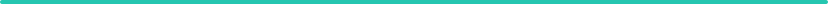
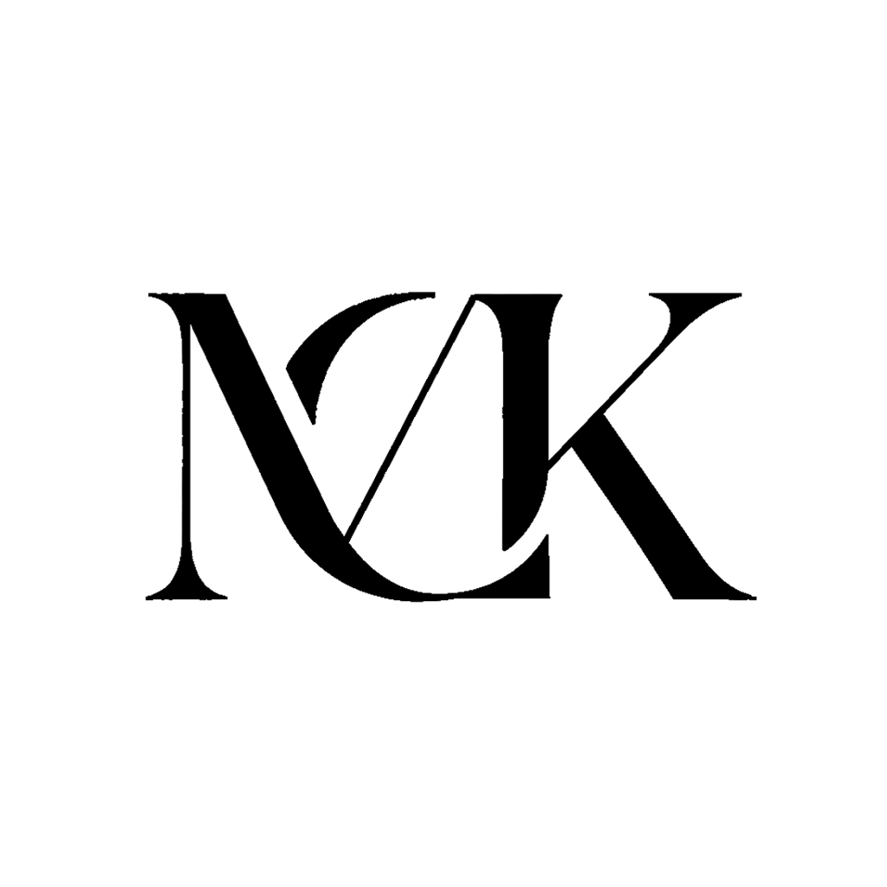

# Mackeabit 

*Curious by default.*

Learning by doing.\
Making everyday things simpler.

### Currently exploring

- **AI & Automation** — Smarter everyday workflows.
- **Systems & Security** — Understanding what runs beneath.
- **Everyday Tools** — Small ideas. Useful changes.

### Tech & Tools

    

### Contribution trail

One small step at a time.

<picture>
  <source media="(prefers-color-scheme: dark)" srcset="./generated/trail-dark.svg">
  
</picture>

*Keep learning. Keep moving.*
